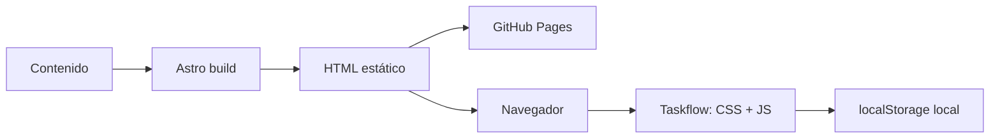
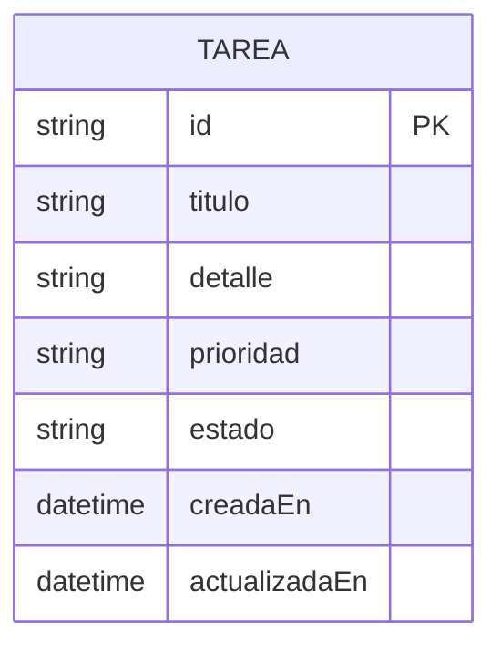

# Arquitectura del sitio

Astro genera tres páginas HTML en compilación. El módulo compartido de datos alimenta las tarjetas y fichas detalladas. CSS y un módulo JavaScript gestionan la presentación y demo local.

La aplicación demostrativa guarda una lista de tareas con título, detalle, prioridad y estado en el navegador. Para múltiples usuarios se requerirían API, autenticación y base de datos remota.

Astro `base` se establece desde `PAGES_BASE`; el workflow usa el nombre del repositorio. `.nojekyll` permite servir los archivos compilados sin procesamiento Jekyll.
